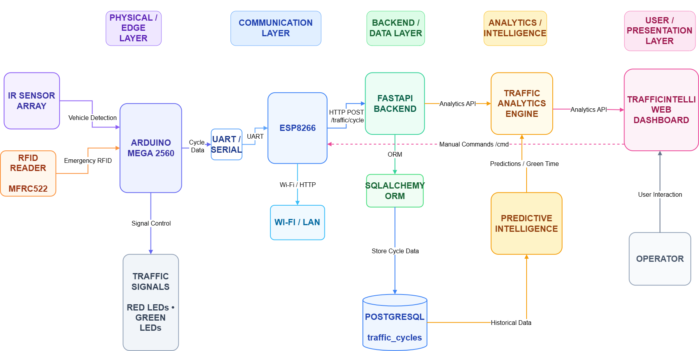
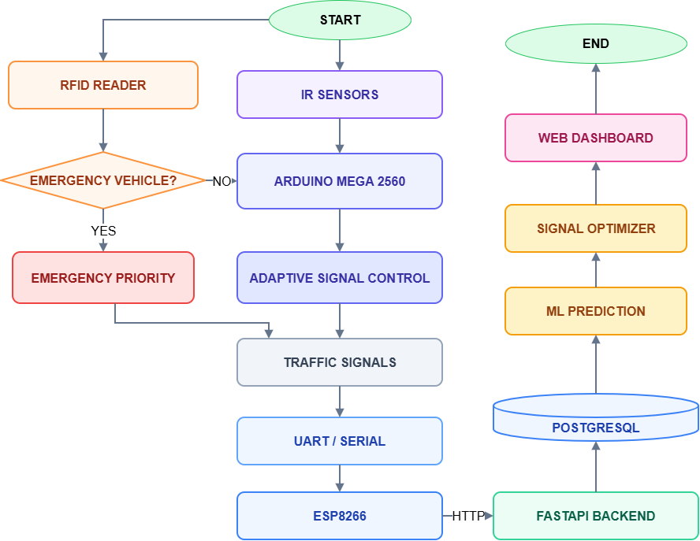

# TrafficIntelli™: Smart AI & IoT-Enabled Adaptive Traffic Management System

[](https://www.python.org/)
[](https://fastapi.tiangolo.com/)
[](https://www.postgresql.org/)
[](https://www.arduino.cc/)
[](https://www.espressif.com/)
[](LICENSE)

**TrafficIntelli™** is a multi-tier Internet of Electronics (IoE) and Artificial Intelligence traffic control system designed to eliminate static traffic light inefficiencies. By integrating real-time edge sensing, RFID-based emergency vehicle preemption, machine learning predictive optimization, and a high-performance web dashboard, TrafficIntelli dynamically balances 4-lane intersection flow in real-time.

---

## 📌 System Architecture

The project is structured into three integrated tiers:

```
┌────────────────────────────────────────────────────────────────────────┐
│                          EDGE HARDWARE TIER                            │
│  [IR Sensors (x8)] ──> [Arduino Mega 2560] <── [MFRC522 RFID Reader]   │
│  [Traffic LEDs]    <── (Real-time I/O)    ──> (Serial1 UART: 9600 Bd)  │
│                                                     │                  │
│                                                     ▼                  │
│                                         [NodeMCU ESP8266 Gateway]      │
│                                         - WiFi HTTP Client & Server    │
│                                         - Fail-safe Packet Retry Queue │
└─────────────────────────────────────────────────────┬──────────────────┘
                                                      │ Wi-Fi / HTTP POST
                                                      ▼
┌────────────────────────────────────────────────────────────────────────┐
│                        BACKEND & ANALYTICS TIER                        │
│                     [FastAPI High-Speed API Server]                    │
│                                     │                                  │
│                 ┌───────────────────┴───────────────────┐              │
│                 ▼                                       ▼              │
│     [PostgreSQL Database]                  [ML Optimization Engine]    │
│     - Raw Cycle Records                    - Pretrained Regressors     │
│     - Historical Telemetry                 - Next-Cycle Predictions   │
│     - Analytics Aggregations               - Dynamic Green Allotment   │
└─────────────────────────────────────┬──────────────────────────────────┘
                                      │ HTTP / REST
                                      ▼
┌────────────────────────────────────────────────────────────────────────┐
│                        WEB OPERATIONS DASHBOARD                        │
│                  [Modern Operations Center UI]                         │
│  - Real-Time Intersection Visualizer     - Chart.js Traffic Analytics  │
│  - Proportional / AI / Manual Control    - Emergency Vehicle Alerts    │
│  - Direct ESP8266 Hardware Relays        - Historical Query Table      │
└────────────────────────────────────────────────────────────────────────┘
```

### Architectural Diagrams

| System Block Diagram | Operational Flowchart |
| :---: | :---: |
|  |  |

---

## ✨ Key Features

1. **Adaptive Density-Based Control (Edge Tier)**:
   * 8 IR sensors track entry and departure across all 4 intersection lanes.
   * Arduino Mega dynamically calculates proportional extra green time for high-density lanes.

2. **RFID Emergency Preemption**:
   * Uses an MFRC522 reader to detect emergency vehicles (e.g., ambulances, fire trucks).
   * Automatically preempts the current green phase, assigns an immediate 20-second green corridor to the emergency lane, and restores normal cycle timing upon clearance.

3. **Machine Learning Predictive Optimization**:
   * Predicts incoming vehicle volume based on time-of-day, day-of-week, and historical cycle trends using scikit-learn / XGBoost regressors.
   * Computes optimal green splits per lane to minimize intersection queuing.

4. **Edge Gateway & Telemetry Buffering**:
   * NodeMCU ESP8266 acts as an intelligent Wi-Fi bridge between Mega UART and FastAPI.
   * Embedded non-blocking retry queue handles network drops without blocking Arduino cycle timing.

5. **Mission Control Web Operations Dashboard**:
   * Live intersection telemetry (vehicle count, queue density, timers, and active lane).
   * Multi-mode operations: Switch between **Proportional**, **AI Predictive**, and **Manual Override**.
   * Comprehensive historical analytics, congestion breakdown charts, and IOE bus event logging.

---

## 📁 Repository Structure

```
TrafficIntelli/
├── backend/                              # FastAPI Backend & Database Services
│   ├── main.py                           # Application entrypoint & REST API endpoints
│   ├── database.py                       # SQLAlchemy database engine & pool configuration
│   ├── models.py                         # PostgreSQL database schemas (TrafficCycle)
│   ├── prediction_service.py             # ML pipeline inference & green-time optimizer
│   ├── signal_optimizer.py               # Cycle duration & green split calculation
│   ├── import_trafficintelli_dataset.py  # Historical synthetic data ingestion utility
│   ├── test_cycle_ingest.py              # Zero-hardware simulation & API test harness
│   └── .env.example                      # Environment variable template
├── dashboard/                            # Web Operations Center
│   ├── index.html                        # Glassmorphism operations dashboard UI
│   ├── style.css                         # Custom responsive styling & design tokens
│   └── script.js                         # State engine, telemetry polling & Chart.js logic
├── ml/                                   # Machine Learning Research & Models
│   ├── dataset/                          # 10,000 synthetic training cycles CSV
│   └── models/                           # Training scripts, tests & exported joblib models
├── sketch_apr6a/                         # Arduino Mega 2560 Firmware
│   └── sketch_apr6a.ino                  # Sensor counting, signal FSM & RFID preemption
├── sketch_apr6b/                         # NodeMCU ESP8266 Firmware
│   └── sketch_apr6b.ino                  # Wi-Fi gateway, HTTP dispatch & telemetry server
├── Diagrams/                             # Block diagrams, flowcharts, and architecture XMLs
├── commands.txt                          # Quick-reference step-by-step execution cheatsheet
└── .gitignore                            # Git exclusion rules
```

---

## 🚀 Getting Started

### 1. Prerequisites
* **Python**: 3.10 or higher
* **PostgreSQL**: 14 or higher running on port `5432`
* **Arduino IDE**: 1.8.x or 2.x with ESP8266 board support installed

### 2. Dependencies Installation
```powershell
pip install fastapi "uvicorn[standard]" sqlalchemy psycopg2-binary scikit-learn pandas numpy joblib xgboost pydantic requests
```

### 3. Database Setup
Create the PostgreSQL database (the backend will automatically initialize tables on start):
```sql
CREATE DATABASE trafficintelli;
```
Configure your credentials in `backend/.env` or set environment variables:
```env
DB_USER=postgres
DB_PASSWORD=YOUR_PASSWORD
DB_HOST=localhost
DB_PORT=5432
DB_NAME=trafficintelli
```

### 4. Running the Backend Server
```powershell
cd backend
python -m uvicorn main:app --host 0.0.0.0 --port 8001 --reload
```
* **Swagger Documentation**: [http://localhost:8001/docs](http://localhost:8001/docs)
* **ReDoc**: [http://localhost:8001/redoc](http://localhost:8001/redoc)

### 5. Launching the Web Dashboard
Serve the dashboard via any local HTTP server (prevents browser CORS and fetch restrictions):
```powershell
cd dashboard
python -m http.server 5500
```
Open **[http://localhost:5500](http://localhost:5500)** in your browser.

---

## 🔌 Hardware Configuration & Pinout

### Arduino Mega 2560 Pinout

| Component | Sensor / Function | Arduino Mega Pin |
| :--- | :--- | :--- |
| **Lane 1 (North)** | IR Far / IR Near | Pins 23, 22 |
| | Red LED / Green LED | Pins 24, 25 |
| **Lane 2 (West)** | IR Far / IR Near | Pins 27, 26 |
| | Red LED / Green LED | Pins 28, 29 |
| **Lane 3 (South)** | IR Far / IR Near | Pins 31, 30 |
| | Red LED / Green LED | Pins 32, 33 |
| **Lane 4 (East)** | IR Far / IR Near | Pins 35, 34 |
| | Red LED / Green LED | Pins 36, 37 |
| **ESP8266 Comms** | Hardware Serial1 TX / RX | Pin 18 (TX1), Pin 19 (RX1) |
| **MFRC522 RFID** | Hardware SPI MISO / MOSI / SCK | Pins 50 (MISO), 51 (MOSI), 52 (SCK) |
| | SDA (SS) / RST / Power | Pin 53 (SS), Pin 5 (RST), **3.3V (VCC)** |

> ⚠️ **Important RFID Wiring Note**: Connect RC522 VCC strictly to **3.3V**, never 5V. On Arduino Mega, SPI clock and data lines are located on pins **50–52** (not pins 11–13 as on Arduino Uno).

### NodeMCU ESP8266 Pinout
* **RX Pin (GPIO3)** $\rightarrow$ Connected to Arduino Mega **TX1 (Pin 18)**
* **TX Pin (GPIO1)** $\rightarrow$ Connected to Arduino Mega **RX1 (Pin 19)**
* **GND** $\rightarrow$ Common Ground with Arduino Mega

---

## ⚙️ Network & IP Configuration

Before deploying the firmware and launching the dashboard on your local network:

1. **Find your PC IPv4 Address**:
   * Run `ipconfig` in Command Prompt / PowerShell.
   * Note your active adapter's IPv4 address (e.g., `192.168.1.50`).

2. **Configure NodeMCU Firmware** ([`sketch_apr6b.ino`](sketch_apr6b/sketch_apr6b.ino)):
   ```cpp
   const char* ssid     = "YOUR_WIFI_SSID";
   const char* password = "YOUR_WIFI_PASSWORD";
   const char* apiHost  = "YOUR_PC_IP"; // Set to your PC's IPv4
   const int   apiPort  = 8001;
   ```

3. **Configure Operations Dashboard** ([`dashboard/script.js`](dashboard/script.js)):
   ```javascript
   const ESP_URL = "http://YOUR_ESP8266_IP"; // Printed on ESP Serial Monitor upon boot
   const BACKEND_URL = "http://localhost:8001"; // or "http://YOUR_PC_IP:8001" for mobile access
   ```

*(See [commands.txt](commands.txt) for a complete troubleshooting guide regarding client isolation, mobile hotspots, and firewall rules.)*

---

## 🧪 Simulation Testing (No Hardware Required)

You can validate the entire pipeline (API ingestion, PostgreSQL logging, and ML prediction) without physical hardware:

1. **Seed Synthetic Historical Data**:
   ```powershell
   cd backend
   python import_trafficintelli_dataset.py
   ```
2. **Execute Ingestion Harness**:
   ```powershell
   cd backend
   python test_cycle_ingest.py http://127.0.0.1:8001
   ```
3. Open `http://localhost:5500` and switch between **Proportional** and **AI Predictive** modes to view real-time calculations.

---

## 📄 License
This project is licensed under the [MIT License](LICENSE).
